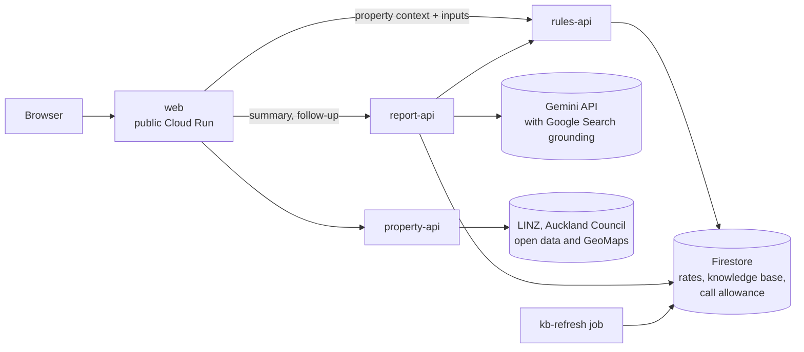

# Home in Brief

Home in Brief is a free information tool for first-home buyers and new migrant families looking at a home in Auckland,
New Zealand. Enter an address and, if you like, your loan details (deposit, income, debts). The page puts what official
records say in one place: Auckland Council hazard layers (flood, coastal, landslide and others), the council's capital
value (CV), annual council rates and title type, repayment ranges at banks' published interest rates under current
lending rules (loan-to-value and debt-to-income limits, First Home Loan) and notes quoted from official sources. Gemini
rewords these facts into a short summary and answers follow-up questions in the language they are asked in. Each
summary sentence that states a fact is checked against the sources it cites and links to them.

**Live demo: https://web-380630050242.australia-southeast1.run.app**

It is information only, not financial, legal or insurance advice. It does not rate risk, and it does not replace a
LIM (Land Information Memorandum) report, a building inspection or advice from your lawyer, lender or insurer.

Submission for AI Builder Cup 2026. It uses Google's Gemini (`gemini-3.5-flash-lite`) and runs on Cloud Run.

## How it works



Data flow for one address:

1. The user picks an address; **web** relays to **property-api**, which builds a `PropertyContext` from LINZ and
   Auckland Council data. Every field has a `status` (`found` / `not_found` / `unavailable`) and a reason, so "not
   found" is never presented as "no risk".
2. web sends the property context and the user's inputs to **rules-api**. It calculates loan amount, LVR
   (loan-to-value ratio), DTI (debt-to-income ratio), repayment scenarios per bank and the First Home Loan scenario
   with plain code, and selects which knowledge-base items apply. rules-api never calls a language model.
3. **report-api** takes the three documents (property context, user inputs, rules output) and produces the summary,
   next steps and follow-up answers (next section).
4. A Cloud Run **job**, `kb-refresh`, re-checks knowledge-base quotes against their source pages. It is run by hand;
   the weekly schedule described in `DEPLOY.md` (section 10) is not set up yet. Bank rates are entered by hand (see
   Data sources).

web is the only public service. property-api, rules-api and report-api are private Cloud Run services; callers use
Google ID tokens.

The page calls web's `POST /api/report` and `POST /api/followup`; web fetches the `PropertyContext` and `RulesOutput`
on the server side and sends them to report-api, so the browser never supplies the property records or the calculated
figures.

## How Gemini is used

Gemini (Google AI) is called by one service, report-api: to reword the summary and, in follow-ups, to classify the
question, answer from the facts, translate fixed sentences and answer with Google Search grounding. Code owns the
facts, except Google Search answers in follow-ups, which are shown as returned and marked as not checked (below). The
default model is `gemini-3.5-flash-lite` (`GEMINI_MODEL`). Details: `services/report-api/README.md`.

**Summary: code writes the facts, Gemini only rewords them.**

1. Code turns the property context, user inputs and rules output into a numbered **fact list**. Each fact has a draft
   sentence, its source ids, and its values as placeholders such as `{{F1.flood_plain_pct}}`.
2. Gemini rewrites the facts into 3-5 plain-language sentences. It never sees a number: digits, years, amounts and
   title names are placeholders, and code fills in the values afterwards.
3. A **validator** checks every sentence: it must cite known sources (taken from the facts, never from Gemini); no
   digit outside a placeholder; numbers must match the cited source fields; no verdict, advice or prediction words; no
   URLs; at most 25 words; qualifiers such as "may" or "only" must survive the rewrite.
4. A sentence that fails is **dropped and replaced by the draft sentence** of its facts, so the summary always shows
   something checked. The count of blocked sentences is returned as `dropped`.

**When Gemini is not available.** If a call is refused by the service's own call allowance, fails or times out, the page
shows the program's own sentences, built from the same facts and checked the same way, and says the model was not used.

**Follow-up questions.** Gemini first classifies the question (out of scope, a stated year built or cladding,
suggested links). Code checks the extracted year or cladding value, merges it into the user's inputs without
overriding a value the council records, **re-calls rules-api** with it, and Gemini answers from the new fact list.
Answers go through the same validator (at most 3 sentences). An out-of-scope question that public web pages can answer
(schools, commute), an in-scope factual question the facts do not answer, or a question that only asks what a term or
document is ("What is a LIM report?") and that the facts do not answer, is answered with Gemini's Google Search grounding, shown exactly as returned with its search
suggestions and sources, and marked as not checked by this tool; an answer that judges this property, gives a verdict
wording the program knows, or (for a definition) is not about the term is not shown. Advice, verdicts, predictions and
any question with a purchase clause are never searched and get one fixed refusal and links; a
purchase question that also names a report topic ("should I buy, it's in a flood plain") gets the program's own
sentences only: a fixed sentence saying the tool cannot decide for the buyer, then the checked fact drafts on that
topic, with no Gemini wording or translation. When the
records lack the year built, cladding or last sale and the question asks for it, report-api searches for that field
the same way; a year or cladding found there fills the inputs, marked "from a web search, not checked", except where
the address is one of several units on a site (Unit Title, Cross Lease, or more than one title type), where it is
shown but not filled in. The page's "Search the web" button beside one of these fields sends the same request.
Question history is treated as untrusted data and never becomes evidence.

**Languages.** The summary is in English. A follow-up is answered in the language of the question, with terms such as
LVR, DTI and First Home Loan, publisher and layer names kept in English; fixed program sentences are translated under
checks (numbers, terms and negation kept) or left in English, so, apart from those terms, a sentence is in one language.

**Why this design.** Home-buying numbers must be right and traceable. A language model is good at plain wording and
bad at being reliably exact, so the numbers, the sources and the selection of knowledge come from code and
human-verified quotes, and Gemini is limited to phrasing that the validator can check. Every summary sentence that
states a fact carries the ids of the sources it was checked against. Three things are not checked this way, and the
page marks each: fixed program sentences, which cite nothing; answers from Google Search, which list the web pages
Google used; and a year built or cladding filled in from such a search. The validator is lexical, not semantic: a
rewrite that keeps all the listed words but subtly changes the relation between them can pass (documented in the
report-api README).

## Data sources and terms

- **Property data:** LINZ (Land Information New Zealand) Data Service (CC BY 4.0) for addresses, parcels and title
  type; Auckland Council open data for hazard layers; Auckland Council GeoMaps for the rating valuation (GeoMaps
  terms: personal and business use, no substantial copying); the council's property page, read once per lookup for the
  build decade, floor area, building site coverage and local board. Nothing is bulk-copied; each lookup queries per
  property. Credit lines are returned in `sources[].attribution`. Full table: `services/property-api/README.md`.
- **Our services do not read listing sites.** No service in this repo requests Homes.co.nz, OneRoof or the Natural
  Hazards Commission's Natural Hazards Portal; the page links to them (the Homes.co.nz and OneRoof links open the
  first DuckDuckGo result for the address). A Google Search answer in a follow-up may quote such sites: it comes from
  Gemini's search, is shown as returned with its sources and is marked as not checked.
- **Website terms gate automation.** Every bank in `jobs/rates-refresh/config/banks.yaml` and every source in
  `kb/seed/sources.json` carries a `tos_status` (`allowed`, `unclear` or `prohibited`) with its terms URL and review
  date (reviewed 2026-10-03, not legal advice). Jobs fetch only `allowed` entries, send an honest `User-Agent`,
  honour `robots.txt`, and treat a block or bot challenge as final: no browser workaround, no bypass.
- **Bank interest rates are updated by hand.** No bank is `allowed` for automated fetching, so `data/rates_seed.json`
  is a manual snapshot from each bank's public rates page (`RATES_UPDATE.md`), with a `captured_at` per bank. The page
  shows the snapshot date. `jobs/rates-refresh`, which would fetch a bank's rates page and extract the rates with
  Gemini, is kept in the repo but is not in use: it fetches only banks marked `allowed`, and there are none.
- **Knowledge base: 35 of 35 items are `verified`.** Each item holds a word-for-word quote from an official source,
  checked by a person against the source (`kb/MANUAL_CHECK.md`). `kb-refresh` never edits item text and downgrades an
  item whose quote disappears. Quotes are shown with source name, URL and licence text.
- The CV is an Auckland Council rating valuation, not a market price.

## Repository layout

| Path | What it is |
|---|---|
| `services/web/` | Public service: the page (plain HTML/JS, Leaflet map) and a relay to the private services |
| `services/property-api/` | Address search and `PropertyContext`: hazards, valuation, title, links, sources |
| `services/rules-api/` | FastAPI: loan, LVR, DTI, repayment scenarios, First Home Loan, applicable knowledge-base items |
| `services/report-api/` | Gemini layer: fact list, rewrite, validator, follow-up |
| `jobs/rates-refresh/` | Rates extraction job, gated by bank terms (not in use) |
| `jobs/kb-refresh/` | Job that re-checks knowledge-base quotes |
| `shared/b_common/` | Pydantic schemas and data access (local files or Firestore) |
| `kb/` | Knowledge-base seed items and sources, validator, `MANUAL_CHECK.md` |
| `data/` | `rates_seed.json`, the hand-maintained rates snapshot |
| `scripts/` | Seed, smoke-test and evaluation scripts |
| `.github/` | Deploy workflow and `deploy/targets.json` |
| `openapi.json` | OpenAPI contract for rules-api |

Docs: `LOCAL.md` (run locally), `DEPLOY.md`, `RATES_UPDATE.md`, `CODES.md` (API codes and warnings).

## Run locally

Needs Python 3.12 and [uv](https://docs.astral.sh/uv/). From the repo root:

```bash
make setup          # venv + every service's requirements + pytest
make local-api      # rules-api on :8080 (local files, no cloud account)
make smoke          # second shell: /healthz and /v1/rules (expects loan 880000, LVR 88.0, DTI 6.07)
REPORT_MOCK=true make local-report   # report-api on :8090, no Gemini key needed
```

For the page, run property-api and web as in `services/web/README.md` (needs a free `LINZ_API_KEY` in `.env`; copy
`.env.example`). Real Gemini calls need `GEMINI_API_KEY` in `.env`. Docker plus Firestore emulator:
`make up`, `make seed`, `make smoke`, `make down`. More in `LOCAL.md`.

## Test

```bash
make test    # runs four suites: test-b (rules-api, both jobs, kb), test-property-api, test-web, test-report-api
```

property-api and web tests replay stored real responses and need no network or key. The report-api golden-case
evaluation is `scripts/eval_report_api.py`.

## Deploy

Pushes to `main` run the tests in GitHub Actions (`.github/workflows/deploy.yml`) and then deploy changed services
and jobs to Cloud Run, with Firestore as the database. Google Cloud login uses Workload Identity Federation, so there
are no key files. Services and jobs are listed in `.github/deploy/targets.json`. One-time setup and details:
`DEPLOY.md`.

## API (rules-api)

| Method and path | Purpose |
|---|---|
| `GET /health` | Liveness check (use this when deployed: Cloud Run reserves some paths ending in `z`) |
| `GET /healthz` | Same response, for local use |
| `POST /v1/rules` | Loan, LVR, DTI, repayment scenarios and the ids of applicable knowledge-base items |
| `GET /v1/kb/items?ids=a,b` | Knowledge-base items (quote, source URL, `source_id`, licence); all visible items if `ids` is empty |
| `GET /v1/rates/latest` | Latest bank rates snapshot (404 if none loaded) |
| `GET /v1/sources` | Sources behind the knowledge base, with `attribution`, `tos_status`, `tos_url` and `tos_checked_at` (join on an item's `source_id`) |

Only `verified` knowledge-base items are returned. `openapi.json` is the contract for all request and response
fields; codes, warnings, flags and the error format are in `CODES.md`. The First Home Loan income caps used are
$95,000 for a single applicant and $150,000 for two or more applicants or a single applicant with dependants (Kāinga
Ora First Home Loan brochure, quoted in `kb/seed/lending.json`).

Example (a $1,000,000 property by CV, $120,000 deposit, $150,000 household income, $30,000 other debts):

```bash
curl -s http://localhost:8080/v1/rules -H 'Content-Type: application/json' -d '{
  "property_context": {"property": {"cv": {"status": "found", "value": 1000000, "valuation_date": "2024-05-01"}}},
  "user_inputs": {"deposit": 120000, "household_income": 150000, "existing_debts": 30000,
                  "household_type": "multiple"}
}'
```

The CV is used only when `cv.status` is `"found"`. The response includes `loan_amount` (880000), `lvr_pct` (88.0),
`dti` (6.07), `scenarios`, `kb_items`, `rates_snapshot_date` and `warnings`.

In production rules-api is a private Cloud Run service; callers authenticate with a Google ID token (`DEPLOY.md`,
section 11).

## Limitations

- **The council property page does not always answer.** The build decade, floor area, building site coverage and
  local board come from it; when it gives no answer they are `unavailable`, the page says so, and the user can enter
  the year built and cladding. Cladding and last sale have no free licensed source and are always `unavailable` from
  property-api.
- Answers from Google Search in follow-ups, and a year built or cladding filled in from one, are not checked against
  any record; the page marks them.
- Gemini calls are limited by a call allowance. When it is used up, or a call fails, the page shows the program's own
  sentences and says so.
- Build decade is a range from the council property category, for residential and lifestyle properties only.
- Address search is a prefix match. Hazard layers say what the council data shows; absence is not "no hazard".
- Bank interest rates are a manual snapshot for 11 lenders and can be out of date. Non-bank lenders are not covered.
- Calculations are simplified (for example fixed-rate owner-occupier scenarios) and are not a lender's assessment.
- The summary validator is lexical (see How Gemini is used); the page gives information, not advice.
- Covers Auckland today. Other regions are planned: addresses, parcels and titles (LINZ), lending rules, bank rates
  and most knowledge-base notes already apply nationwide, while hazard layers, valuations and council rates come from
  each council and need their own data and terms check.

## Licence

To be decided by the team.
