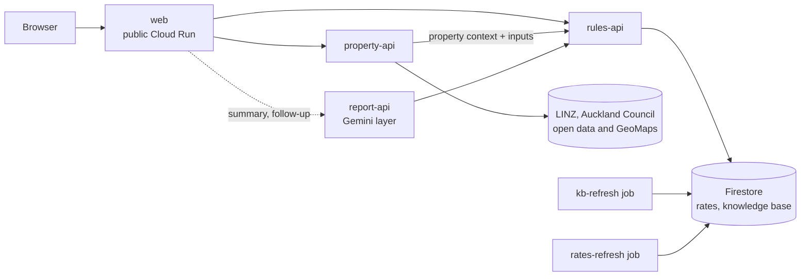

# Home Buyer Copilot

A free pre-offer report for first-time home buyers in Auckland, New Zealand. Enter an address and your loan details
(deposit, income, debts) and get a plain-English view of what the property could really cost and where the risks
are: council hazard layers (flood, coastal, landslide and others), affordability under current lending rules (LVR and
DTI limits, repayments at each bank's published rate, First Home Loan), knowledge-base notes quoted from official
sources, a short summary written with Gemini, and follow-up questions.

**Live demo: https://web-380630050242.australia-southeast1.run.app**

This is general information, not financial, legal or insurance advice. Verify everything with a licensed adviser,
lawyer and insurer before you make an offer. Submission for AI Builder Cup 2026.

## How it works



Data flow for one report:

1. The user picks an address; **web** relays to **property-api**, which builds a `PropertyContext` from LINZ and
   Auckland Council data. Every field has a `status` (`found` / `not_found` / `unavailable`) and a reason, so "not
   found" is never presented as "no risk".
2. web sends the property context and the user's inputs to **rules-api**. It calculates loan amount, LVR, DTI,
   repayment scenarios per bank and the First Home Loan view with plain code, and selects which knowledge-base items
   apply. rules-api never calls a language model.
3. **report-api** takes the three documents (property context, user inputs, rules output) and produces the summary,
   next steps and follow-up answers (next section).
4. Two Cloud Run **jobs** keep data fresh: `kb-refresh` re-checks knowledge-base quotes against their source pages,
   `rates-refresh` extracts bank rates with Gemini, but only from pages whose terms allow it (see Data sources).

web is the only public service. property-api, rules-api and report-api are private Cloud Run services; callers use
Google ID tokens.

The page calls web's `POST /api/report` and `POST /api/followup`; web fetches the `PropertyContext` and
`RulesOutput` on the server side and sends them to report-api, so the browser never supplies the facts.

## How Gemini is used

Gemini (Google AI) is used in three places, always behind code that owns the facts: report-api (summary and follow-up),
and `jobs/rates-refresh` (extracting rates from a bank page, when a bank's terms allow it). The default model is
`gemini-3.5-flash-lite` (`GEMINI_MODEL`). Details: `services/report-api/README.md`.

**Summary: code writes the facts, Gemini only rewords them.**

1. Code turns the property context, user inputs and rules output into a numbered **fact list**. Each fact has a draft
   sentence, its source ids, and its values as placeholders such as `{{F1.flood_plain_pct}}`.
2. Gemini rewrites the facts into 3-5 plain-language sentences. It never sees a number: digits, years, amounts and
   title names are placeholders, and code fills in the values afterwards.
3. A **validator** checks every sentence: it must cite known sources (taken from the facts, never from Gemini); no
   digit outside a placeholder; numbers must match the cited source fields; no verdict, advice or prediction words; no
   URLs; at most 25 words; qualifiers such as "may" or "only" must survive the rewrite.
4. A sentence that fails is **dropped and replaced by the draft sentence** of its facts, so the report always shows
   something checked. The count of blocked sentences is returned as `dropped`.

**Follow-up questions.** Gemini first classifies the question (out of scope, a stated year built or cladding,
suggested links). Code checks the extracted year or cladding value, merges it into the user's inputs without
overriding a value the council records, **re-calls rules-api** with it, and Gemini answers from the new fact list.
Answers go through the same validator (at most 3 sentences). An out-of-scope question that public web pages can
answer is answered with Gemini's Google Search grounding, shown as returned with its search suggestions and sources
and marked as not checked by this service (the Gemini API terms do not allow it to be edited); advice, verdicts and
predictions get one fixed refusal and links. Question history is treated as untrusted data and never becomes
evidence.

**Languages.** The report is in English. A follow-up is answered in the language of the question, with terms such as
LVR, DTI and First Home Loan kept in English; fixed program sentences are translated under checks (numbers, terms
and negation kept) or left in English, so an answer never mixes languages within a sentence.

**Why this design.** Home-buying numbers must be right and traceable. A language model is good at plain wording and
bad at being reliably exact, so the numbers, the sources and the selection of knowledge come from code and
human-verified quotes, and Gemini is limited to phrasing that the validator can check. Every sentence in the report
carries the ids of the sources it relies on. The validator is lexical, not semantic: a rewrite that keeps all the
listed words but subtly changes the relation between them can pass (documented in the report-api README).

## Data sources and terms

- **Property data:** LINZ Data Service (CC BY 4.0) for addresses, parcels and title type; Auckland Council open data
  for hazard layers; Auckland Council GeoMaps for the rating valuation (GeoMaps terms: personal and business use, no
  substantial copying). Nothing is bulk-copied; each report queries per property. Credit lines are returned in
  `sources[].attribution`. Full table: `services/property-api/README.md`.
- **Website terms gate automation.** Every bank in `jobs/rates-refresh/config/banks.yaml` and every source in
  `kb/seed/sources.json` carries a `tos_status` (`allowed`, `unclear` or `prohibited`) with its terms URL and review
  date (reviewed 2026-10-03, not legal advice). Jobs fetch only `allowed` entries, send an honest `User-Agent`,
  honour `robots.txt`, and treat a block or bot challenge as final: no browser workaround, no bypass.
- **Rates are updated by hand.** No bank is `allowed` for automated fetching, so `data/rates_seed.json` is a manual
  snapshot from each bank's public rates page (`RATES_UPDATE.md`), with a `captured_at` per bank. The report shows
  the snapshot date.
- **Knowledge base: 31 of 31 items are `verified`.** Each item holds a word-for-word quote from an official source,
  checked by a person against the source (`kb/MANUAL_CHECK.md`). `kb-refresh` never edits item text and downgrades an
  item whose quote disappears. Quotes are shown with source name, URL and licence text.
- The CV is an Auckland Council rating valuation, not a market price.

## Repository layout

| Path | What it is |
|---|---|
| `services/web/` | Public service (A): report page (plain HTML/JS, Leaflet map) and a relay to the private services |
| `services/property-api/` | (A) Address search and `PropertyContext`: hazards, valuation, title, links, sources |
| `services/rules-api/` | (B) FastAPI: loan, LVR, DTI, repayment scenarios, First Home Loan, applicable knowledge-base items |
| `services/report-api/` | (B) Gemini layer: fact list, rewrite, validator, follow-up |
| `jobs/rates-refresh/` | (B) Rates extraction job, gated by bank terms |
| `jobs/kb-refresh/` | (B) Weekly job that re-checks knowledge-base quotes |
| `shared/b_common/` | Pydantic schemas and data access (local files or Firestore) |
| `kb/` | Knowledge-base seed items and sources, validator, `MANUAL_CHECK.md` |
| `data/` | `rates_seed.json`, the hand-maintained rates snapshot |
| `scripts/` | Seed, smoke-test and evaluation scripts |
| `.github/` | Deploy workflow and `deploy/targets.json` |
| `openapi.json` | OpenAPI contract for rules-api |

Docs: `LOCAL.md` (run locally), `DEPLOY.md`, `RATES_UPDATE.md`, `CODES.md` (API codes and warnings).

## Run locally

Needs Python 3.12 and [uv](https://docs.astral.sh/uv/). From the repo root:

```bash
make setup          # venv + every service's requirements + pytest
make local-api      # rules-api on :8080 (local files, no cloud account)
make smoke          # second shell: /healthz and /v1/rules (expects loan 880000, LVR 88.0, DTI 6.07)
REPORT_MOCK=true make local-report   # report-api on :8090, no Gemini key needed
```

For the page, run property-api and web as in `services/web/README.md` (needs a free `LINZ_API_KEY` in `.env`; copy
`.env.example`). Real Gemini calls need `GEMINI_API_KEY` in `.env`. Docker plus Firestore emulator:
`make up`, `make seed`, `make smoke`, `make down`. More in `LOCAL.md`.

## Test

```bash
make test    # runs four suites: test-b (rules-api, both jobs, kb), test-property-api, test-web, test-report-api
```

property-api and web tests replay stored real responses and need no network or key. The report-api golden-case
evaluation is `scripts/eval_report_api.py`.

## Deploy

Pushes to `main` run the tests in GitHub Actions (`.github/workflows/deploy.yml`) and then deploy changed services
and jobs to Cloud Run, with Firestore as the database. Google Cloud login uses Workload Identity Federation, so there
are no key files. Services and jobs are listed in `.github/deploy/targets.json`. One-time setup and details:
`DEPLOY.md`.

## API (rules-api)

| Method and path | Purpose |
|---|---|
| `GET /health` | Liveness check (use this when deployed: Cloud Run reserves some paths ending in `z`) |
| `GET /healthz` | Same response, for local use |
| `POST /v1/rules` | Loan, LVR, DTI, repayment scenarios and the ids of applicable knowledge-base items |
| `GET /v1/kb/items?ids=a,b` | Knowledge-base items (quote, source URL, `source_id`, licence); all visible items if `ids` is empty |
| `GET /v1/rates/latest` | Latest bank rates snapshot (404 if none loaded) |
| `GET /v1/sources` | Sources behind the knowledge base, with `attribution`, `tos_status`, `tos_url` and `tos_checked_at` (join on an item's `source_id`) |

Only `verified` knowledge-base items are returned. Set `INCLUDE_DRAFT=true` (done in `docker-compose.yml`) to include
`draft` items for development; the response flags this with `kb_includes_draft`. 
The `first_home_loan` scenario has a `lenders[]` list, one entry per partner lender. A value that is not known is `null`
with `rate_basis: "unknown"`, and a note says when eligibility is conditional. The income caps used are $95,000 for a
single applicant and $150,000 for two or more applicants or a single applicant with dependants.
`openapi.json` is the contract for all request and response fields.

Errors use one format for every 4xx and 5xx response: `{"error": {"code": "...", "message": "...", "fields": [{"field": "...", "message": "..."}]}}`.
Response codes, warnings and flags are explained in `CODES.md`.

Example (a $1,000,000 property by CV, $120,000 deposit, $150,000 household income, $30,000 other debts):

```bash
curl -s http://localhost:8080/v1/rules -H 'Content-Type: application/json' -d '{
  "property_context": {"property": {"cv": {"status": "found", "value": 1000000, "valuation_date": "2024-05-01"}}},
  "user_inputs": {"deposit": 120000, "household_income": 150000, "existing_debts": 30000,
                  "household_type": "multiple"}
}'
```

The CV is used only when `cv.status` is `"found"`. The response includes `loan_amount` (880000), `lvr_pct` (88.0), `dti` (6.07), `scenarios`, `kb_items`,
`rates_snapshot_date` and `warnings`.

In production rules-api is a private Cloud Run service; callers authenticate with a Google ID token (`DEPLOY.md`, section 11).

## Limitations

- **Council property pages cannot be read from the live server** (the council site refuses it), so build era and
  similar fields are often unavailable online; the user can enter the year built and cladding, and the report says
  when a field could not be found. Cladding and last sale have no free licensed source and are always `unavailable`
  from property-api.
- Build decade is a range from the council property category, for residential and lifestyle properties only.
- Address search is a prefix match (about 2 seconds per query). Hazard layers say what the council data shows; absence
  is not "no hazard".
- Rates are a manual snapshot for 11 lenders and can be out of date. Non-bank lenders are not covered.
- Calculations are simplified (for example fixed-rate owner-occupier scenarios) and are not a lender's assessment.
- The summary validator is lexical (see How Gemini is used); the report is information, not advice.
- Auckland only.

## Team

- **A:** property-api and web.
- **B:** rules-api, jobs, knowledge base and report-api.

## License

To be decided by the team.
